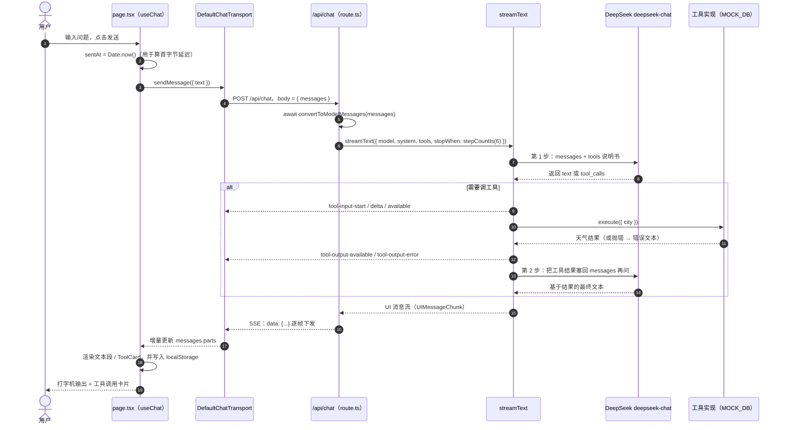
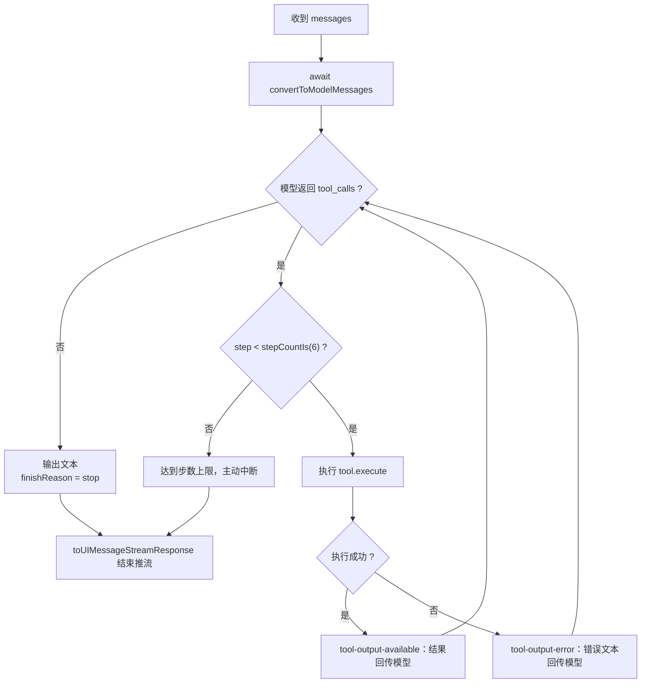

# Demo 1 · 询问-回答完整流程图

> 对应代码：`src/app/page.tsx`（前端）+ `src/app/api/chat/route.ts`（服务端）
> 模型：DeepSeek `deepseek-chat`（OpenAI 兼容，`.chat()` 模式）

## 一、端到端时序图

## 二、服务端循环决策（对应 Demo 0 的那个 `while`）

**与 Demo 0 的对应关系**：这个循环就是 `agent.js` 里 `while (step < maxSteps)` 的 SDK 版本 ——
判空 `tool_calls` = 结束条件；`stepCountIs(6)` = `maxSteps`；错误回传 = `try/catch` 里的 `{ error }`。

## 三、SSE 事件 → 前端表现对照

| SSE 事件 | 前端发生什么 |
| --- | --- |
| `start` / `start-step` | `status: submitted → streaming`，记下首字节延迟 |
| `text-start` / `text-delta` / `text-end` | 文本段落打字机逐字输出 |
| `tool-input-start` / `tool-input-delta` | ToolCard 展开，显示「🔧 get_weather · 正在解析参数…」 |
| `tool-input-available` | 展示入参（如 `{ "city": "北京" }`） |
| `tool-output-available` | ToolCard 折叠，展示 `output` |
| `tool-output-error` | ToolCard 展示 `errorText`（模型拿到后会自己纠错） |
| `finish-step` / `finish` | `status: ready`，解锁输入框 |
| 连接失败 | `error` 非空 → 错误条（重试 / 忽略），页面不崩 |

## 四、三个关键位置（照着断点）

| 想看什么 | 看哪里 |
| --- | --- |
| 请求怎么发出 | `page.tsx` 的 `handleSubmit` → `sendMessage({ text })` |
| 工具在哪被执行 | `route.ts` 里 `tool({ execute })`（仍是你自己的代码，模型只输出意图） |
| 前端怎么渲染过程 | `page.tsx` 的 `message.parts.map` + `isToolUIPart(part)` / `getToolName(part)` |
